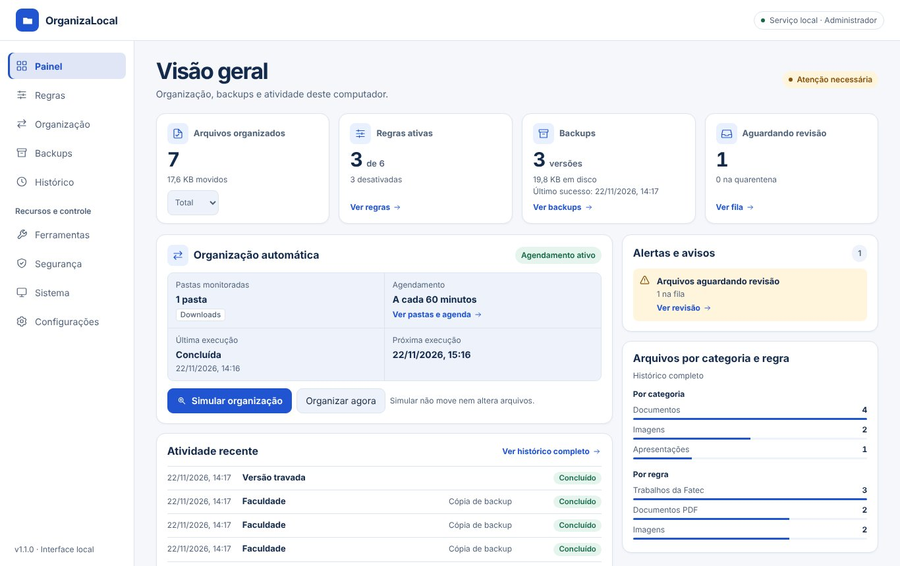

# OrganizaLocal

**Organização automática de arquivos e backups versionados, rodando no seu computador.**

Projeto Integrador da disciplina de **Sistemas Operacionais** — Análise e Desenvolvimento de Sistemas, FATEC Itapetininga (2026).
Orientador: Prof. Me. Deivison S. Takatu.

| | |
|---|---|
| **Instalar o programa** | [Instaladores para Windows e Linux](Instaladores/) |
| Painel (site) | https://organiza-local.vercel.app *(abre e controla o programa local)* |
| Versão | 1.2.0 |
| Sistemas | Windows 10/11 e Linux |
| Linguagem | Python 3.10+ (somente biblioteca padrão, funciona offline) |




---

## 1. Objetivo e problema

A pasta **Downloads** vira um depósito: PDFs da faculdade, boletos, instaladores, imagens e planilhas misturados. Organizar à mão toma tempo e quase ninguém faz backup dos arquivos importantes.

O **OrganizaLocal** é um serviço que roda em segundo plano e:

1. **organiza automaticamente**, de hora em hora (padrão), os arquivos de uma pasta escolhida (padrão: Downloads), movendo cada um para a pasta definida por **regras criadas pelo usuário** — por extensão, palavra no nome, categoria, formato real do conteúdo, tamanho ou data, com **prioridade** e **exceções**;
2. faz **backups periódicos por regras**, guardando até **N versões** (padrão **5**) e apagando as mais antigas automaticamente;
3. registra **tudo** num histórico local: o que foi movido, de onde, para onde, por qual regra e quando.

O painel abre no navegador, seja pela **interface local** ou pelo **site publicado na Vercel**, conforme a configuração. O serviço em `http://127.0.0.1:8765` processa os arquivos no computador. Quando o site configurado está indisponível, o atalho abre a interface local.

## 2. Integrantes

| Integrante | Responsabilidades principais |
|---|---|
| Bernardo | Gestão das regras, definição de prioridades e análise dos resultados da execução |
| Kauã Oliveira Lopes | Validação e testes das regras, identificação de conflitos de nomes e revisão da documentação |
| Kayky Gabriel Silvano Tomé | Arquitetura, desenvolvimento do motor de regras e integração com a Vercel |
| Matheus | Levantamento dos requisitos funcionais e não funcionais, realização de backups, segurança e elaboração de relatórios |
| Reinaldo Gomes da Silva Filho | Elaboração de histórias adicionais, realização de testes e simulações e consolidação da documentação 

> As contribuições de cada integrante podem ser conferidas no histórico de commits do GitHub (`git shortlog -sn`). Como trabalhar no repositório (branches, testes e pull requests): [`CONTRIBUTING.md`](CONTRIBUTING.md).

## 3. Tecnologias

- **Python 3.10+**, somente biblioteca padrão: `os`, `shutil`, `pathlib`, `hashlib`, `zipfile`, `tarfile`, `subprocess`, `threading`, `http.server`, `json`, `ctypes`. Não precisa de `pip install`.
- **HTML, CSS e JavaScript puro** na interface, publicada na **Vercel** como site estático.
- **Shell Script (Bash)** para instalar e automatizar no Linux, e **PowerShell/Batch** no Windows.
- **cron** (Linux) e a pasta **Inicializar** (Windows) para o início automático.
- **Git e GitHub** para o versionamento, e **unittest/pytest** para os testes.

## 4. Conceitos de Sistemas Operacionais aplicados

| Conceito | Onde aparece no projeto | Por que foi escolhido |
|---|---|---|
| **Manipulação de arquivos e diretórios** | `organizer.py`: `os.walk`, `os.stat`, `os.rename`, `shutil.copy2`, `mkdir` | É o coração do problema: ler, mover, copiar e criar pastas. |
| **Sistema de arquivos (mesmo disco × outro disco)** | `Organizer.transfer()`: no mesmo disco usa `os.rename`, uma troca atômica da entrada do diretório. Entre discos, copia, confere o SHA-256 e só então apaga a origem. | Mostra a diferença entre mover e copiar no nível do SO e garante integridade (RNF05). |
| **Permissões** | `os.access` antes de mover; pasta de dados com `chmod 700`; `session.json` com `chmod 600`; `chmod 755` no instalador | Evitar movimentações não autorizadas (RNF03) e proteger o token. |
| **Processos** | `cli.py`: o serviço roda como processo separado (`subprocess.Popen` com `start_new_session`/`DETACHED_PROCESS`), arquivo de PID, encerramento por sinal (`SIGTERM`) ou `taskkill`; a aba Sistema mostra PID, PPID, RSS e threads | Um organizador automático precisa rodar em segundo plano, independente do terminal. |
| **Threads e concorrência** | Agendador em thread própria; `ThreadingHTTPServer` com uma thread por requisição; `threading.Lock` impede duas organizações simultâneas | Fazer o agendamento e atender o site ao mesmo tempo. |
| **Agendamento de tarefas** | Organização de hora em hora e backups por intervalo (`scheduler.py`); `@reboot` no cron; `agendar_cron.sh` (`0 * * * *`); pasta Inicializar do Windows | É o requisito principal: organizar sozinho periodicamente. |
| **Memória, CPU e disco** | `sysinfo.py` lê `/proc/meminfo`, `/proc/self/status` e `os.getloadavg` no Linux, e `GlobalMemoryStatusEx`/`GetProcessMemoryInfo` via `ctypes` no Windows; `shutil.disk_usage` antes de cada backup | Monitorar os recursos e não lotar o disco com backups. |
| **Variáveis de ambiente** | `APPDATA`, `XDG_DATA_HOME`, `HOME`/`USERPROFILE`, `ORGANIZALOCAL_DATA`, `ORGANIZALOCAL_PORT`; o instalador do Windows altera o `PATH` do usuário | Achar a pasta certa de cada usuário em cada SO. |
| **Execução de comandos do SO** | 7-Zip/unrar via `subprocess`, `xdg-open`/`explorer` para abrir pastas, `crontab`, `df`, `free`, `ps` nos scripts | Integrar com ferramentas já existentes no sistema. |
| **Registro de informações operacionais** | `history/events.jsonl` (log só de acréscimo), relatórios PDF, `verificar_sistema.sh` | Rastreabilidade: o que aconteceu, quando e por quê. |
| **Rede local (loopback)** | Servidor ligado somente a `127.0.0.1`, com CORS e `Access-Control-Allow-Private-Network` | O site público fala com o programa local sem expor nada na rede. |

Mais detalhes em [`docs/conceitos-so.md`](docs/conceitos-so.md).

## 5. Funcionalidades

**Requisitos do grupo (HU01–HU12 / RF01–RF14):**

- Regras por **extensão** (HU01), por **palavra no nome** (HU02) e com pasta de destino (RF03). A detecção lê as origens da regra e mostra o total de arquivos por extensão.
- **Prioridade** de 0 a 10, com os botões **Aumentar/Diminuir prioridade** e empate indicado e enviado para revisão (HU03, HU04, RF11).
- **Exceções** que impedem mover ou redirecionam para outra pasta, verificadas antes da regra (HU05).
- Consultar, editar, excluir com confirmação, ativar e desativar regras (HU06–HU09).
- **Simulação** que não move nada (HU10), **execução** com tratamento de conflitos (HU11) e **resultado** com falhas e motivos (HU12).

Os requisitos não funcionais (RNF01–RNF10), as extensões de escopo e os requisitos legados estão detalhados na [matriz de cobertura](COBERTURA_REQUISITOS.md).

**Interface da versão 1.2.0:**

- **Painel "Visão geral"** com indicadores (arquivos organizados por período, regras ativas, versões de backup e fila de revisão), situação da organização automática, alertas e atividade recente.
- **Assistente de regra em três etapas** (*Origem → Tipos e destino → Revisão*). A etapa **Origem** oferece pastas específicas, com sua própria opção de subpastas, ou as pastas monitoradas, que acompanham as Configurações. Na revisão, é possível **Simular esta regra**, **Salvar desativada** ou, após simular em um perfil com permissão de análise, **Salvar e ativar**.
- **Catálogo de tipos de arquivo** com grupos expansíveis, busca por extensão, filtro por categoria e por estado, contador de selecionadas e detecção nas origens. A seleção permanece ao filtrar e detectar novamente. O catálogo sinaliza as extensões usadas por outras regras ativas.
- **Assistente de backup em 3 etapas** (*Origem → Destino e frequência → Revisão*), com frequência diária, semanal ou a cada X horas e opções avançadas de formato, filtros e retenção.
- **Histórico com filtros** por texto, tipo de atividade, status e período, com exportação em CSV e PDF do histórico filtrado.
- **Seletor nativo de pasta e arquivo** no Windows, acessível pela barra de tarefas, além do campo de caminho completo.
- **Pareamento local.** Na tela **Conectar ao programa**, o botão **Enviar código** abre um terminal com seis dígitos para usar em **Conectar**. O terminal gráfico no Linux depende do ambiente disponível.
- **Aparência.** Os temas base são Claro, Escuro e Neon. O **Tema premium** adiciona um fundo de luz difusa com controle de animação. A elevação dos controles oferece **Desativada**, **Normal**, **Média** e **Máxima**, com retorno visual no hover e no clique mesmo no nível desativado.
- **Integração.** Salvar uma mudança de painel abre o endereço escolhido na mesma aba, com a sessão atual. A troca pelo site usa a interface publicada a partir desta versão.
- Navegação reorganizada em **Painel, Regras, Organização, Backups e Histórico**, com **Ferramentas, Segurança, Sistema e Configurações** em "Recursos e controle"; ajuda contextual ("Saiba mais"), rascunhos dos assistentes preservados durante a navegação e melhorias de acessibilidade (link para pular ao conteúdo, foco nas etapas, mensagens com `role="status"`).
- Distribuição reorganizada: instaladores prontos em [`Instaladores/`](Instaladores/), scripts de geração em [`empacotamento/`](empacotamento/) e scripts separados em [`scripts/Linux/`](scripts/Linux/) e [`scripts/Windows/`](scripts/Windows/).

O histórico completo de mudanças está em [`CHANGELOG.md`](CHANGELOG.md).

O site da Vercel e os pacotes de [`Instaladores/`](Instaladores/) refletem a revisão de suas respectivas publicações.

**Acrescentado ao pedido do grupo:**

- Organização automática **de hora em hora** (configurável: minutos, diária, semanal ou desligada).
- **Backups por regras** com origens, destino (inclusive HD externo), filtros, horários, **retenção de cinco versões por padrão**, ZIP ou cópia de pastas. Também é possível travar versões, restaurar a versão inteira ou um arquivo, comparar e verificar a integridade.
- **Formato real** lido dos primeiros bytes. Um executável disfarçado de `.jpg` vai para revisão por padrão ou para quarentena quando essa opção está ativa.
- **Instalador** que cria a pasta do aplicativo, o atalho e o início automático.

**Mantido da versão 0.9:**

- Categorias e projetos; glob, regex, tamanho e datas; renomear com modelo (`{date}_{name}`).
- Quarentena, caminhos protegidos e exclusões globais; perfis com PIN e senha para operações críticas.
- Fila de revisão e desfazer movimentações; duplicados por SHA-256; classificação sugerida; sandbox de regras.
- Inspeção e extração de ZIP e TAR. A listagem de 7Z e RAR depende de 7-Zip ou, para RAR, de `unrar`.
- Relatório diário em PDF; limites de espaço; vencimentos de documentos; observações.
- Detecção de alterações externas; versões, importação e exportação da configuração.

## 6. Instalação e execução

### Instalador (recomendado)

Abra a pasta [Instaladores](Instaladores/) na raiz do projeto e escolha o arquivo do seu sistema. Os pacotes também estão disponíveis no painel do OrganizaLocal na seção **Ainda não instalou?**.

| Sistema | Arquivo | Como instalar |
|---|---|---|
| **Windows 10/11** | [OrganizaLocal-Setup-1.2.0.exe](Instaladores/OrganizaLocal-Setup-1.2.0.exe) (9 MB, **Python já incluído**) | Dois cliques → Próximo → Instalar → Concluir. Não precisa de administrador. |
| **Linux** (Ubuntu, Debian, Mint, Pop!_OS) | [organizalocal_1.2.0_all.deb](Instaladores/organizalocal_1.2.0_all.deb) | Dois cliques no arquivo, ou `sudo apt install ./organizalocal_1.2.0_all.deb` na pasta Instaladores |

**Instalador do Windows:**

- Instala o programa e o Python 3.12 oficial em `%LOCALAPPDATA%\Programs\OrganizaLocal` e cria a pasta de dados `%APPDATA%\OrganizaLocal`.
- Cria os atalhos no Menu Iniciar e, opcionalmente, na Área de Trabalho.
- Opcionalmente, inicia o serviço com o Windows, para a organização de hora em hora.
- Adiciona o comando `organizalocal` ao PATH e registra o desinstalador em *Configurações → Aplicativos*.
- Como o instalador não tem assinatura digital paga, o SmartScreen pode avisar na primeira vez. Clique em **Mais informações → Executar assim mesmo**.

**Pacote do Linux:**

- Instala em `/opt/organizalocal` e cria o comando `organizalocal` e o atalho no menu de aplicativos.
- Inicia o serviço ao entrar na sessão, pelo `/etc/xdg/autostart`.
- Os dados de cada usuário ficam em `~/.local/share/OrganizaLocal`.
- Para remover: `sudo apt remove organizalocal`. Os dados são mantidos.

### Scripts (alternativa sem instalador)

**Windows:**

1. Instale o **Python 3.10+** em [python.org](https://www.python.org/downloads/), marcando **"Add python.exe to PATH"**.
2. Dê dois cliques em [scripts/Windows/instalar.bat](scripts/Windows/instalar.bat). Veja os demais comandos no [guia para Windows](scripts/Windows/README.md).

**Linux:**

```bash
git clone https://github.com/Kaykyduken/organiza-local.git
cd organiza-local
bash scripts/Linux/instalar.sh
organizalocal open        # abre o painel (o atalho do menu faz o mesmo)
```

O script cria `~/.local/share/OrganizaLocal` (permissão 700), o comando `~/.local/bin/organizalocal`, o atalho `.desktop` e a entrada `@reboot` no `crontab`.
Veja os demais comandos no [guia para Linux](scripts/Linux/README.md).

### Sem instalar (desenvolvimento)

| Sistema | Comando a partir da raiz do projeto |
|---|---|
| Windows (PowerShell) | `.\scripts\Windows\iniciar.bat serve --local` |
| Linux (terminal) | `bash scripts/Linux/iniciar.sh serve --local` |

Depois, acesse `http://127.0.0.1:8765`.

### Primeiros passos

1. Em **Painel**, clique em **Criar minha primeira regra**. Escolha uma origem própria para a regra ou as pastas monitoradas nas configurações. As regras de exemplo ficam desativadas.
2. Marque os tipos de arquivo no catálogo, escolha o destino e clique em **Simular esta regra**. Confira a prévia e escolha **Salvar e ativar** ou **Salvar desativada**. Salvar guarda a regra para execuções futuras.
3. Em **Organização**, simule todas as regras ou clique em **Organizar agora** e confirme. Em **Histórico**, use os filtros para consultar movimentações, simulações e backups.
4. Em **Backups**, clique em **Criar backup**, selecione o que copiar e revise a frequência e o limite de versões antes de salvar.

O seletor nativo de pasta ou arquivo é oferecido no Windows. O campo de caminho completo também está disponível. Regras salvas antes do assistente continuam usando as pastas monitoradas e podem receber uma origem própria ao editar. Os rascunhos dos assistentes ficam na sessão enquanto você navega pelo painel.

Em **Configurações → Integração → Painel padrão**, escolha **Painel local** ou **Site publicado**. Ao salvar uma troca, a aba navega para o endereço escolhido. O atalho também passa a usar essa preferência.

### Publicação na Vercel

Ao importar o repositório na Vercel com o framework **Other**, o comando em `vercel.json` prepara `dist/site/` com a interface de `web/` e os arquivos de download de `Instaladores/`. Depois, selecione **Site publicado** em **Configurações → Integração** e informe a URL. O instalador por script também aceita `--site` no Linux e `-Site` no Windows.

O Chrome/Edge pede uma vez a permissão de **acesso à rede local**: clique em **Permitir**.

**Verificar a integridade dos instaladores:**

```bash
cd Instaladores
sha256sum -c SHA256SUMS.txt
```

O comando deve retornar `OK` para o instalador do Windows e para o pacote Linux.

## 7. Comandos e scripts de automação

| Comando | O que faz |
|---|---|
| `organizalocal open` | Inicia o serviço em segundo plano, se preciso, e abre o site autenticado |
| `organizalocal serve` | Roda o serviço em primeiro plano (mostra PID e código de pareamento) |
| `organizalocal status` / `stop` | Situação do serviço / encerramento controlado |
| `organizalocal organize [--simular]` | Organiza agora, ou só simula, pelo terminal |
| `organizalocal backup [--job nome]` | Executa as regras de backup |
| `organizalocal relatorio` / `info` / `regras` / `codigo` | Relatório PDF / dados do SO / regras / código de pareamento |

| Script | Uso |
|---|---|
| [scripts/Linux/instalar.sh](scripts/Linux/instalar.sh) · [scripts/Windows/instalar.bat](scripts/Windows/instalar.bat) | Instalação completa (pasta do app, atalhos, início automático) |
| [scripts/Linux/desinstalar.sh](scripts/Linux/desinstalar.sh) · [scripts/Windows/desinstalar.bat](scripts/Windows/desinstalar.bat) | Remove o programa e mantém os dados por padrão |
| [scripts/Linux/verificar_sistema.sh](scripts/Linux/verificar_sistema.sh) | Relatório de CPU, memória, disco, processo, permissões, cron e últimas operações, salvo em `reports/` |
| [scripts/Linux/backup_agora.sh](scripts/Linux/backup_agora.sh) `[nome]` | Backup pelo terminal, com código de saída (ideal para cron) |
| [scripts/Linux/agendar_cron.sh](scripts/Linux/agendar_cron.sh) `[--remover]` | Agenda a organização a cada hora e o backup às 02h30 via cron |
| [scripts/Linux/iniciar.sh](scripts/Linux/iniciar.sh) · [scripts/Windows/iniciar.bat](scripts/Windows/iniciar.bat) | Executa direto do repositório |

## 8. Como testar

```bash
python -m unittest discover -s tests -q  # recomendado; não exige dependências externas
# opcional, se pytest estiver instalado:
python -m pytest -q
```

São **102 testes automatizados** em `tests/`, executados no Windows e no Ubuntu. A suíte cobre:

- cada história de usuário (HU01–HU12);
- a lógica dos fluxos guiados, incluindo origem própria, simulação de rascunho, prévia de nomes, filtros do histórico, delegação ao seletor nativo e persistência da aparência (`test_fluxos.py`);
- integridade SHA-256 e conflitos sem sobrescrever;
- retenção de 5 versões e versões travadas;
- restauração e comparação de backups;
- API e abertura do painel, incluindo token, CORS, troca de origem, pareamento, permissões de perfil e comandos do atalho;
- extração ZIP com bloqueio de `../`, PDF, agendador e migração da versão 0.9.

Cada teste roda numa pasta temporária isolada.

**Verificação manual reproduzível:**

1. Coloque em Downloads um `trabalho_fatec.pdf`, um `boleto.pdf` e um `foto.jpg`.
2. Ative as regras "Arquivos da faculdade", "Documentos PDF" e "Imagens".
3. Clique em **Simular** e confira:
   - `trabalho_fatec.pdf` → Faculdade (prioridade 8 vence a 5);
   - `boleto.pdf` → exceção, não move;
   - `foto.jpg` → Imagens.
4. Clique em **Organizar agora** e confira as pastas e a aba **Histórico**.
5. Crie uma regra de backup e clique 6 vezes em "Fazer backup agora", alterando um arquivo entre as execuções. Só as 5 versões mais recentes ficam.
6. Rode `bash scripts/Linux/verificar_sistema.sh`.

Rastreabilidade completa em [`COBERTURA_REQUISITOS.md`](COBERTURA_REQUISITOS.md).

## 9. Prints e documento do projeto

O documento completo do projeto (estrutura de mini TCC, com prints de cada etapa) está em [`docs/OrganizaLocal_Documento_Projeto.docx`](docs/OrganizaLocal_Documento_Projeto.docx). As capturas de tela ficam em [`docs/prints/`](docs/prints).

**Interface da versão 1.1.0:**

| Etapa | Print |
|---|---|
| Painel (visão geral) | [`v11_painel.jpg`](docs/prints/v11_painel.jpg) |
| Assistente de regra — 1. Origem | [`v11_regra_1_origem.jpg`](docs/prints/v11_regra_1_origem.jpg) |
| Assistente de regra — 2. Tipos e destino | [`v11_regra_2_tipos_destino.jpg`](docs/prints/v11_regra_2_tipos_destino.jpg) |
| Assistente de regra — 3. Revisão e simulação | [`v11_regra_3_simulacao.jpg`](docs/prints/v11_regra_3_simulacao.jpg) |
| Lista de regras | [`v11_regras.jpg`](docs/prints/v11_regras.jpg) |
| Simulação da organização (não move nada) | [`v11_organizacao_simulacao.jpg`](docs/prints/v11_organizacao_simulacao.jpg) |
| Assistente de backup | [`v11_backup_assistente.jpg`](docs/prints/v11_backup_assistente.jpg) |
| Backups com versões (uma travada 🔒) | [`v11_backups_versoes.jpg`](docs/prints/v11_backups_versoes.jpg) |
| Histórico com filtros | [`v11_historico.jpg`](docs/prints/v11_historico.jpg) |

**Terminal, instalação e versão 1.0.0** (usados no documento do projeto):

| Etapa | Print |
|---|---|
| Instalação no Linux | [`t01_instalacao.jpg`](docs/prints/t01_instalacao.jpg) |
| Aba Sistema (conceitos de SO) | [`d15_sistema.jpg`](docs/prints/d15_sistema.jpg) |
| Testes automatizados | [`t05_testes.jpg`](docs/prints/t05_testes.jpg) |
| Interface antiga: resultado e fila de revisão | [`d08_resultado.jpg`](docs/prints/d08_resultado.jpg) |

## 10. Estrutura do repositório

```text
organiza-local/
├── src/organizalocal/   # código-fonte Python (comentado)
│   ├── storage.py       # pasta de dados, config, histórico, SHA-256
│   ├── rules.py         # condições, prioridade, exceções, formato real
│   ├── organizer.py     # simulação, movimentação segura, revisão, ferramentas
│   ├── backups.py       # backups por regras, versões, retenção, restauração
│   ├── archives.py      # ZIP/TAR/RAR/7Z
│   ├── security.py      # token, pareamento, perfis, PIN, senha crítica
│   ├── scheduler.py     # agendador (thread)
│   ├── reports.py       # estatísticas, PDF, limites, vencimentos
│   ├── sysinfo.py       # CPU, memória, disco, processo, variáveis de ambiente
│   ├── native_picker.py # seletor nativo de pasta/arquivo no Windows (PowerShell)
│   ├── server.py        # API HTTP em 127.0.0.1
│   └── cli.py           # comandos de terminal
├── web/                 # site publicado na Vercel (HTML/CSS/JS)
│   ├── index.html       # estrutura e navegação
│   ├── app.js           # estado, API, painel, organização e histórico
│   ├── journeys.js      # componentes de formulário e assistente de regra
│   ├── workspace-views.js # assistente de backup, ferramentas, segurança e configurações
│   └── styles.css
├── scripts/
│   ├── Linux/           # instalação, inicialização e utilitários em Bash
│   └── Windows/         # instalação e inicialização em Batch e PowerShell
├── Instaladores/        # arquivos prontos para Windows (.exe) e Linux (.deb)
├── empacotamento/       # scripts e recursos para gerar os instaladores
├── tests/               # testes automatizados
├── docs/                # conceitos de SO, prints e documento do projeto
├── vercel.json
├── CHANGELOG.md         # histórico de versões
├── CONTRIBUTING.md      # como trabalhar no repositório
├── COBERTURA_REQUISITOS.md
└── README.md
```

## 11. Limitações conhecidas

- O programa precisa estar em execução para organizar sozinho. O instalador o coloca no início automático.
- A organização é por varredura periódica, e não por eventos instantâneos do sistema de arquivos.
- No Linux, `st_ctime` é a data da última mudança de metadados, e não a data de criação.
- RAR e 7Z só podem ser inspecionados, e isso exige o 7-Zip instalado.
- A quarentena reconhece executáveis por extensão e pelos bytes iniciais. **Não é antivírus.**
- Perfis e PIN controlam o painel, mas não substituem as contas de usuário do sistema operacional.
- O site da Vercel depende do navegador permitir o acesso à rede local (Chrome/Edge recentes perguntam). Se não houver permissão, use a interface local em `http://127.0.0.1:8765`.
- Não há criptografia dos backups.
- O seletor nativo de pasta/arquivo só existe no Windows. No Linux, o caminho é digitado ou colado no campo.
- Foi testado em Linux (Debian/Ubuntu). O Windows foi validado pelo código e pelos scripts, e precisa de teste na máquina de apresentação.

## 12. Possíveis melhorias

Monitoramento por eventos (inotify/ReadDirectoryChangesW), backups incrementais e criptografados, ícone na bandeja do sistema, seletor nativo de pastas também no Linux (portal XDG/zenity), empacotamento como executável (PyInstaller) e sincronização de regras entre computadores.
